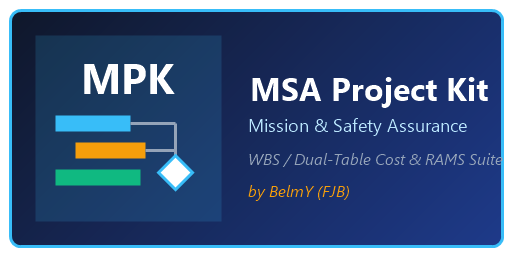

  

# MPK — MSA Project Kit (by FJB)

Standalone desktop project management suite tailored for Mission & Safety Assurance (MSA/RAMS) engineering workflows, featuring integrated WBS task/milestone injection, advanced dual-table budgeting (tasks & roles), document control signatures, and professional PDF/Print exports.

## Credits & Acknowledgements
- **Original Viewer Core:** Based on the open-source [Gantit](https://github.com/) project. Deep gratitude to the original author.
- **Standalone Desktop Architecture & PRO Extensions:** Customized, packaged, and maintained by **[belmy](https://github.com/belmy)** (FJB).

## Tech Stack
- Electron, Node.js / V8, Chromium
- MPXJ (Microsoft Project data interchange)
- Electron-Builder